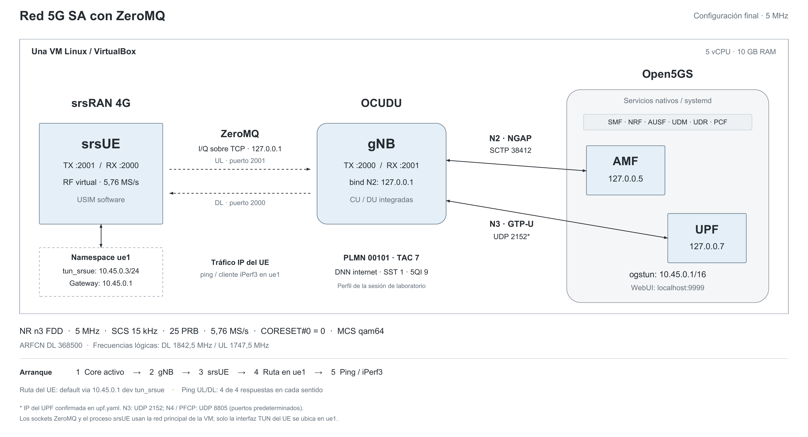

# Red 5G SA con OCUDU, srsUE y Open5GS en DragonOS

Tutorial paso a paso para montar una red 5G SA completamente software en una VM: **Open5GS nativo + OCUDU gNB + srsUE por ZeroMQ**, sin Docker ni equipos de radio.

La ejecución documentada usa **DragonOS Focal R37**, un canal de **5 MHz**, **25 PRB** y una tasa de muestreo de **5,76 MS/s**. Incluye los archivos finales del laboratorio, las capturas de instalación y las pruebas de conectividad.



[Figura vectorial](assets/arquitectura.pdf) · [Capturas en orden](docs/evidencias.md) · [Solución de errores](docs/errores.md) · [Publicar este repositorio](docs/publicar-github.md)

## 00. Alcance y resultado

Este trabajo adapta el [tutorial oficial de OCUDU con srsUE](https://docs.ocudu.org/tutorials/srsue/). La organización está inspirada en [my-srsproject-demo](https://github.com/devopsjourney23/my-srsproject-demo); los comandos y archivos se adaptan a la instalación nativa de este laboratorio.

| Aspecto | Configuración documentada |
|---|---|
| Sistema declarado | DragonOS Focal R37 en VirtualBox |
| Base observada en APT | Repositorios Ubuntu **jammy / 22.04**; comprobar el sistema antes de añadir repositorios |
| Recursos finales asignados | 5 vCPU y 10 GB de RAM; no son requisitos mínimos medidos |
| Core | Open5GS 2.8.0 instalado por paquetes, con systemd |
| gNB | OCUDU 26.10.0, commit `b78d09a77a` |
| UE nuevo | srsRAN 4G / srsUE 25.10.0, commit `bef8680d5` |
| UE anterior en el PATH | srsUE 23.4.0 en `/usr/local/bin/srsue` |
| Celda | n3 FDD, SCS 15 kHz, 5 MHz, 25 PRB |
| PLMN / TAC / slice | `00101` / `7` / SST `1` |
| Sesión | DNN `internet`, IPv4, 5QI `9` |
| Resultado observado | Sesión PDU con IP `10.45.0.3`; ping en ambos sentidos con 4/4 respuestas |

Los archivos de `config/` son los entregados desde la VM, no una reconstrucción del chat. Los pasos de instalación combinan comandos visibles en las capturas con preparaciones explícitas para poder repetirlos. Esos ajustes editoriales están identificados en [procedencia y verificación](docs/procedencia.md).

El laboratorio fue ejecutado por su autor y está respaldado por capturas. Esta edición del tutorial se verificó estáticamente; no se reinstaló la VM durante su preparación. La IP del UE puede cambiar en cada sesión. Las capturas parciales de iPerf3 no permiten afirmar un rendimiento sostenido ni acceso a Internet externo.

## Contenido

1. [Preparar la VM](#01-preparar-la-vm)
2. [Instalar MongoDB y Open5GS](#02-instalar-mongodb-y-open5gs)
3. [Instalar la WebUI](#03-instalar-la-webui)
4. [Compilar OCUDU](#04-compilar-ocudu)
5. [Actualizar srsRAN 4G](#05-actualizar-srsran-4g)
6. [Configurar el core](#06-configurar-el-core)
7. [Registrar el abonado](#07-registrar-el-abonado)
8. [Configurar gNB y UE](#08-configurar-gnb-y-ue)
9. [Arrancar la red](#09-arrancar-la-red)
10. [Configurar las rutas](#10-configurar-las-rutas)
11. [Probar la conectividad](#11-probar-la-conectividad)
12. [Medir con iPerf3](#12-medir-con-iperf3)
13. [Detener y volver a arrancar](#13-detener-y-volver-a-arrancar)
14. [Referencias](#14-referencias)

Todos los comandos siguientes son para **Bash dentro de la VM Linux**, salvo las instrucciones de publicación. Abre una terminal por componente cuando se indique.

## 01. Preparar la VM

Comprueba el sistema real. El nombre comercial de DragonOS no basta para elegir repositorios Ubuntu:

```bash
cat /etc/os-release
lsb_release -a
uname -m
free -h
nproc
df -h /
ip -br addr
```

En las capturas aparecen repositorios `jammy`, arquitectura x86_64, la interfaz `enp0s3` con IP `10.0.2.15/24` y puerta de enlace de la VM `10.0.2.2`. Estos valores de VirtualBox son de aquella ejecución; no deben forzarse si tu VM muestra otros.

**Los comandos de repositorios de esta guía se aplican al caso Jammy observado.** Si `/etc/os-release` indica Focal/20.04 u otra base, usa los repositorios compatibles con ella antes de continuar; no mezcles distribuciones.

Instala las herramientas de construcción. La lista reúne las dependencias visibles de srsRAN y las necesarias para construir el gNB en una VM que no las tenga preinstaladas:

```bash
sudo apt update
sudo apt install -y \
  git build-essential cmake pkg-config curl gnupg ca-certificates \
  software-properties-common \
  libfftw3-dev libmbedtls-dev libsctp-dev libyaml-cpp-dev libgtest-dev \
  libboost-program-options-dev libconfig++-dev \
  libusb-1.0-0-dev libzmq3-dev libuhd-dev \
  iproute2 iputils-ping net-tools iperf3
```

DragonOS ya incluye herramientas SDR; instalar dependencias no exige reemplazar sus binarios de srsRAN. Se compilará en carpetas separadas. Dos trabajos de compilación (`-j2`) ayudan a contener el uso de RAM.

Si `apt update` informa índices que no pudo descargar, resuelve el problema antes de instalar. En esta instalación hubo fallos independientes de acceso HTTP a Ubuntu, acceso a Launchpad y DNS: ver [errores de red](docs/errores.md#apt-ppa-y-dns).

## 02. Instalar MongoDB y Open5GS

### MongoDB 8.0 para el caso Jammy

La captura del repositorio usa MongoDB 8.0 sobre Jammy. El paso de importar su clave no quedó capturado; se completa aquí siguiendo el proveedor.

```bash
curl -fsSL https://pgp.mongodb.com/server-8.0.asc -o /tmp/mongodb-server-8.0.asc
sudo gpg --dearmor --yes \
  -o /usr/share/keyrings/mongodb-server-8.0.gpg /tmp/mongodb-server-8.0.asc

echo 'deb [arch=amd64,arm64 signed-by=/usr/share/keyrings/mongodb-server-8.0.gpg] https://repo.mongodb.org/apt/ubuntu jammy/mongodb-org/8.0 multiverse' \
  | sudo tee /etc/apt/sources.list.d/mongodb-org-8.0.list

sudo apt update
sudo apt install -y mongodb-org
sudo systemctl enable --now mongod
systemctl is-active mongod
```

Resultado esperado: `active`. `enable` se añade para conservar el arranque tras reiniciar; la captura original mostraba MongoDB en ejecución pero su unidad deshabilitada para el inicio automático.

### Open5GS por OBS

El intento con `ppa:open5gs/latest` falló por conexión a Launchpad. La instalación que sí continuó usó el repositorio OBS para Ubuntu 22.04:

```bash
curl -fsSL 'https://build.opensuse.org/projects/home:acetcom/signing_key' \
  -o /tmp/open5gs-obs.asc
gpg --show-keys /tmp/open5gs-obs.asc
sudo gpg --dearmor --yes \
  -o /usr/share/keyrings/open5gs-obs.gpg /tmp/open5gs-obs.asc

echo 'deb [signed-by=/usr/share/keyrings/open5gs-obs.gpg] https://download.opensuse.org/repositories/home:/acetcom:/open5gs:/latest/xUbuntu_22.04/ /' \
  | sudo tee /etc/apt/sources.list.d/open5gs-obs.list

sudo apt update
apt-cache policy open5gs
sudo apt install open5gs
dpkg -l | grep open5gs
systemctl list-units --type=service --all 'open5gs-*' --no-pager
```

En las capturas, el candidato y los paquetes instalados son **2.8.0**. El repositorio se llama `latest` y puede ofrecer otra versión al repetir estos pasos: comprueba la salida antes de aplicar las configuraciones de esta guía. No se adjunta un mirror de paquetes que congele todas las dependencias.


## 03. Instalar la WebUI

### Node.js usado en el laboratorio

La instalación fotografiada empleó Node.js **18.20.8**:

```bash
curl -fsSL https://deb.nodesource.com/setup_18.x -o /tmp/nodesource-setup.sh
sudo -E bash /tmp/nodesource-setup.sh
sudo apt install nodejs
node --version
npm --version
```

Esto documenta el entorno histórico que funcionó. **Node 18 está fuera de soporte**, como ya advertía el instalador en la captura. Para mantener una instalación nueva, valida una rama LTS soportada compatible con la WebUI; esa actualización no fue probada en esta VM. Consulta el [estado oficial de Node.js](https://nodejs.org/en/about/previous-releases).

### WebUI de Open5GS

Comprueba DNS antes de descargar el instalador:

```bash
getent hosts open5gs.org
curl -I --connect-timeout 10 https://open5gs.org
```

Si falla la resolución pero hay conectividad IP, aplica el [diagnóstico de DNS](docs/errores.md#apt-ppa-y-dns). Con la descarga operativa:

```bash
curl -fsSL https://open5gs.org/open5gs/assets/webui/install -o /tmp/open5gs-webui-install.sh
sudo -E bash /tmp/open5gs-webui-install.sh
sudo systemctl status open5gs-webui --no-pager
```

El instalador de aquella ejecución creó y habilitó `open5gs-webui.service`; no se escribió una unidad personalizada manualmente. Su proceso observado es `/usr/bin/node server/index.js`, con directorio de trabajo `/usr/lib/node_modules/open5gs`.

Abre **http://localhost:9999** en el navegador **de la VM**. El usuario inicial del tutorial es `admin` y su contraseña inicial es `1423`, si no la cambiaste. Cambia la contraseña de tu instalación. No se incluyen archivos `.env`, secretos JWT ni una exportación de la base de usuarios en este repositorio.


## 04. Compilar OCUDU

Se conserva el mismo directorio de las capturas. El checkout explícito fija la revisión observada en vez de depender del estado futuro de la rama principal:

```bash
git --version
mkdir -p ~/srsran_project
cd ~/srsran_project
git clone https://gitlab.com/ocudu/ocudu.git
cd ocudu
git checkout b78d09a77ab060cda752f32483e551f1e9132f66

mkdir -p build
cd build
cmake .. -DENABLE_ZEROMQ=ON -DENABLE_UHD=ON
make -j2

./apps/gnb/gnb --version
grep -E 'ENABLE_ZEROMQ:BOOL|ENABLE_UHD:BOOL' CMakeCache.txt
```

La captura muestra **OCUDU 26.10.0 (`b78d09a77a`)**, compiladores GNU 11.4.0 y ambos drivers habilitados. UHD estaba disponible en DragonOS; esta conexión utiliza ZeroMQ. No hace falta ejecutar `sudo make install`: se usará el binario de `build/apps/gnb`.


Si ya existe la carpeta, inspecciona su estado con `git status` y comprueba sus cambios antes de repetir un checkout. No borres el árbol para empezar de nuevo. Los comandos anteriores presuponen una carpeta de clonación nueva.

## 05. Actualizar srsRAN 4G

### Distinguir el srsUE antiguo del nuevo

```bash
command -v srsue
srsue --version
```

La instalación anterior resolvía a `/usr/local/bin/srsue` y mostraba **23.4.0**. Compilar otra versión no cambia automáticamente ese PATH. Tampoco necesitamos arrancar `srsepc`: el core de esta red es Open5GS.

### Compilar la revisión utilizada

```bash
cd ~
git clone https://github.com/srsran/srsRAN_4G.git srsRAN_4G_ocudu
cd ~/srsRAN_4G_ocudu
git checkout bef8680d5f9714f3e040e6f9cbc88d7888439b6d
git log -1 --format='%h %ad %s' --date=short
git describe --tags --always

mkdir -p build
cd build
cmake .. -DCMAKE_BUILD_TYPE=Release -DENABLE_ZEROMQ=ON
cmake --build . -j2

find ~/srsRAN_4G_ocudu/build -type f -name srsue -executable
~/srsRAN_4G_ocudu/build/srsue/src/srsue --version
```

Las capturas muestran `release_25_10-14-gbef8680d5` y **Version 25.10.0**, con el plugin ZeroMQ activo. El historial pasó primero por `release_23_11`, pero después cambió a `master`; por eso esta guía fija el commit posterior y omite el checkout intermedio. “Versión nueva utilizada” es más preciso que “última versión”, que cambia con el tiempo.

`Release`, ZeroMQ explícito y `-j2` hacen repetible la intención de configuración y moderan la carga. Las capturas usaron `cmake ..` (Release por defecto) y construyeron con `-j"$(nproc)"`.


Desde este punto, **usa siempre** `~/srsRAN_4G_ocudu/build/srsue/src/srsue`.

## 06. Configurar el core

Descarga/clona este repositorio en la VM o copia su carpeta. Los comandos relativos a `config/` se ejecutan desde su raíz. Por ejemplo, si se guardó en `~/dragonos-5g-sa-zmq`:

```bash
cd ~/dragonos-5g-sa-zmq
```

### Direcciones finales

| Interfaz / función | Dirección | Protocolo o función |
|---|---|---|
| AMF N2 | `127.0.0.5:38412` | NGAP / SCTP; puerto estándar usado por gNB |
| gNB N2 bind | `127.0.0.1` | Configurado en `cu_cp.amf.bind_addr` |
| AMF SBI | `127.0.0.5:7777` | HTTP / SBI |
| SMF PFCP | `127.0.0.4` | N4; UDP 8805 por defecto |
| UPF PFCP / GTP-U | `127.0.0.7` | N4 / N3; UDP 8805 / 2152 por defecto |
| NRF SBI | `127.0.0.10:7777` | Descubrimiento de funciones |
| SCP | `127.0.0.200:7777` | Proxy SBI usado por AMF y SMF |
| Pool IPv4 | `10.45.0.0/16` | Sesiones SMF/UPF |
| `ogstun` en la VM | `10.45.0.1/16` | Gateway de datos; MTU observado 1400 |
| `tun_srsue` en `ue1` | `10.45.0.3/24` en la prueba | IP de sesión dinámica; máscara de `[gw]` |

Las IP de core se confirman en los archivos finales. Los puertos de N3/N4 omitidos en YAML son los valores de protocolo predeterminados, no una captura de sockets. No se ha definido un bind N3 explícito del gNB en `gnb_zmq.yaml`.

### Instalar las configuraciones entregadas

Se incluyen [amf.yaml](config/open5gs/amf.yaml), [nrf.yaml](config/open5gs/nrf.yaml), [smf.yaml](config/open5gs/smf.yaml) y [upf.yaml](config/open5gs/upf.yaml), conservando sus comentarios originales. Para Open5GS 2.8.0 en esta misma topología:

```bash
backup_dir="/etc/open5gs/backup-zmq-$(date +%Y%m%d-%H%M%S)"
sudo mkdir -p "$backup_dir"
for file in amf nrf smf upf; do
  sudo cp -a "/etc/open5gs/$file.yaml" "$backup_dir/"
  sudo install -m 644 "config/open5gs/$file.yaml" "/etc/open5gs/$file.yaml"
done

sudo systemctl restart open5gs-nrfd open5gs-amfd open5gs-smfd open5gs-upfd
systemctl is-active open5gs-nrfd open5gs-amfd open5gs-smfd open5gs-upfd
ip addr show ogstun
```

El PLMN final es **MCC 001 / MNC 01**, TAC **7**, SST **1**. El cambio de identidad se hizo en `amf.guami`, `amf.tai`, `amf.plmn_support` y `nrf.serving`. Se conservaron las direcciones de loopback.

Las líneas YAML `mcc: 001` y `mnc: 01` son exactamente las de los archivos del laboratorio. Evita reserializarlas con una herramienta que elimine ceros iniciales. Los bloques `999/70` que siguen en comentarios son ejemplos de la plantilla, no configuración activa.

La configuración usa SCP. Comprueba también los servicios necesarios para autenticación y descubrimiento, no solo los cuatro anteriores:

```bash
systemctl is-active mongod open5gs-scpd open5gs-ausfd open5gs-udmd open5gs-udrd
systemctl list-units --type=service --all 'open5gs-*' --no-pager
```

Los paquetes y el instalador de WebUI aportan las unidades systemd; esta guía no crea servicios personalizados de gNB o srsUE.

## 07. Registrar el abonado

En la WebUI de la VM, abre **Subscriber → +**, configura los siguientes valores y guarda:

| Campo | Valor del laboratorio |
|---|---|
| IMSI | `001010123456780` |
| Subscriber Key / K | `00112233445566778899aabbccddeeff` |
| Tipo de clave de operador | `OPc` |
| OPc | `63BFA50EE6523365FF14C1F45F88737D` |
| Authentication Management Field | `8000` |
| DNN / APN de la sesión | `internet` |
| SST | `1` |
| 5QI | `9` |

Son credenciales de prueba del ejemplo, también presentes en el archivo UE. El campo de autenticación `AMF=8000` no es la dirección de la función de red AMF. No fijes como IP estática `10.45.0.3`: fue la IP asignada en la prueba.


## 08. Configurar gNB y UE

Desde la raíz de este repositorio:

```bash
mkdir -p ~/zmq_test
cp config/gnb_zmq.yaml ~/zmq_test/gnb_zmq.yaml
cp config/ue_zmq.conf ~/zmq_test/ue_zmq.conf
```

### gNB: configuración exacta

Archivo completo: [config/gnb_zmq.yaml](config/gnb_zmq.yaml).

```yaml
cu_cp:
  amf:
    addr: 127.0.0.5
    port: 38412
    bind_addr: 127.0.0.1
    supported_tracking_areas:
      - tac: 7
        plmn_list:
          - plmn: "00101"
            tai_slice_support_list:
              - sst: 1
  inactivity_timer: 7200

ru_sdr:
  device_driver: zmq
  device_args: tx_port=tcp://127.0.0.1:2000,rx_port=tcp://127.0.0.1:2001,base_srate=5.76e6
  srate: 5.76
  tx_gain: 0
  rx_gain: 0

cell_cfg:
  pdsch:
    mcs_table: qam64
  pusch:
    mcs_table: qam64
  dl_arfcn: 368500
  band: 3
  channel_bandwidth_MHz: 5
  common_scs: 15
  plmn: "00101"
  tac: 7
  pdcch:
    common:
      ss0_index: 0
      coreset0_index: 0
    dedicated:
      ss2_type: common
      dci_format_0_1_and_1_1: false
  prach:
    prach_config_index: 1
```

### srsUE: parámetros esenciales

Archivo completo: [config/ue_zmq.conf](config/ue_zmq.conf), incluidos USIM, NAS y GW.

```ini
[rf]
srate = 5.76e6
nof_antennas = 1
device_name = zmq
device_args = tx_port=tcp://127.0.0.1:2001,rx_port=tcp://127.0.0.1:2000,base_srate=5.76e6

[rat.eutra]
dl_earfcn = 2850
nof_carriers = 0

[rat.nr]
bands = 3
nof_carriers = 1
max_nof_prb = 25
nof_prb = 25

[gw]
netns = ue1
ip_devname = tun_srsue
ip_netmask = 255.255.255.0
```

Este bloque es un extracto: copia el archivo completo del repositorio para conservar K, OPc, IMSI, `[rrc]` y `[nas]`.

### Comprobar coherencia antes de ejecutar

| Parámetro | gNB | srsUE |
|---|---|---|
| DL | TX TCP 2000 | RX TCP 2000 |
| UL | RX TCP 2001 | TX TCP 2001 |
| Muestreo | `srate: 5.76` en MHz | `srate = 5.76e6` en muestras/s |
| Base ZeroMQ | `base_srate=5.76e6` | `base_srate=5.76e6` |
| Ancho de banda | `5` MHz | `25` PRB en ambos campos |

```bash
grep -nE 'srate|channel_bandwidth|coreset0|mcs_table' ~/zmq_test/gnb_zmq.yaml
grep -nE 'srate|prb|netns|ip_devname' ~/zmq_test/ue_zmq.conf
```

Los archivos finales **no añaden parámetros SSB al UE**. La revisión de srsUE usada ya tiene valores por defecto DL ARFCN 368500 y SSB ARFCN 368410, coincidentes con las salidas. La discrepancia con el chat de asistencia se explica en [errores y correcciones](docs/errores.md#ssb-y-el-chat-de-asistencia).

## 09. Arrancar la red

### Terminal 1: core y namespace

```bash
systemctl is-active open5gs-amfd open5gs-upfd open5gs-nrfd open5gs-smfd
sudo ip netns list
```

Solo si `ue1` no existe:

```bash
sudo ip netns add ue1
```

Vuelve a comprobarlo:

```bash
sudo ip netns list
```

### Terminal 2: gNB

```bash
cd ~/srsran_project/ocudu/build/apps/gnb
sudo ./gnb -c ~/zmq_test/gnb_zmq.yaml
```

Espera a ver la celda de **5 MHz** y la conexión al AMF:

```text
Cell pci=1, bw=5 MHz, 1T1R, dl_arfcn=368500 (n3)
Connected to AMF. Supported PLMNs: 00101
==== gNB started ===
```

La salida también muestra DL 1842,5 MHz, SSB ARFCN 368410 y UL 1747,5 MHz. Son parámetros lógicos de la celda; en este montaje las muestras viajan por TCP, no se emite RF física.

### Terminal 3: srsUE

```bash
cd ~/zmq_test
sudo ~/srsRAN_4G_ocudu/build/srsue/src/srsue ue_zmq.conf
```

Secuencia de éxito observada en la captura de conexión 22:

```text
Random Access Complete.
RRC Connected
PDU Session Establishment successful. IP: 10.45.0.3
RRC NR reconfiguration successful.
```

Para diagnóstico puedes añadir `--log.filename=stdout --log.all_level=info`; no es una condición demostrada para que conecte.

**No arranques el proceso srsUE completo con `ip netns exec ue1`.** Se ejecuta en la red principal para acceder al mismo loopback TCP que el gNB. Su sección `[gw]` coloca la interfaz TUN en `ue1`; las aplicaciones ping/iPerf3 sí se lanzan en ese namespace.

Para inspeccionar el core en una terminal adicional:

```bash
sudo tail -n 20 /var/log/open5gs/amf.log
```

`gNB-N2 accepted[127.0.0.1]` confirma el lado AMF. No basta con que `systemctl` muestre procesos activos para concluir que existe una sesión de datos.


## 10. Configurar las rutas

Con gNB y UE activos, desde otra terminal de la VM:

```bash
sudo ip netns exec ue1 ip addr show tun_srsue
sudo ip netns exec ue1 ip route
ip addr show ogstun
ip route show
```

Anota la dirección actual del UE. Si la interfaz no existe o no tiene IP, resuelve primero el error GW/sesión; no añadas una ruta sobre una interfaz inexistente.

```bash
sudo ip netns exec ue1 ip route replace default via 10.45.0.1 dev tun_srsue
sudo ip netns exec ue1 ip route
```

La ejecución original usó `ip route add`. Repetirlo generó `RTNETLINK answers: File exists`; aquí se usa `replace` para poder repetir el paso.

En `ue1` se espera una ruta por defecto vía `10.45.0.1` y una ruta conectada `10.45.0.0/24` por `tun_srsue`. En el host ya existe `10.45.0.0/16` por `ogstun`. La máscara `/24` del UE y el pool `/16` del core son exactamente los de esta prueba.

**No añadas `10.45.0.0/16 via 10.53.1.2`.** Esa ruta era del core Docker del tutorial de referencia. Aquí el core es nativo y su interfaz `ogstun` está en la propia VM.

## 11. Probar la conectividad

### Iniciar ping desde el UE (UL)

```bash
sudo ip netns exec ue1 ping 10.45.0.1 -c 4
```

### Iniciar ping desde el host hacia el UE (DL)

En la sesión fotografiada la IP era `10.45.0.3`. Usa la obtenida en el paso anterior si cambia:

```bash
ping 10.45.0.3 -c 4
```


| Prueba de la captura | Enviados / recibidos | Pérdida | RTT medio |
|---|---|---|---|
| Desde `ue1` hacia `10.45.0.1` | 4 / 4 | 0 % | 358,567 ms |
| Desde el host hacia `10.45.0.3` | 4 / 4 | 0 % | 214,461 ms |

Cada ping incluye solicitud y respuesta; UL/DL indica el lado que lo inicia. Esto respalda conectividad bidireccional local, sin demostrar rendimiento sostenido ni acceso WAN.

## 12. Medir con iPerf3

Los comandos siguientes forman una prueba repetible propuesta. La captura histórica muestra una prueba parcial; no se recuperan todos sus argumentos ni el resumen final.

Servidor en una terminal del host de la VM:

```bash
iperf3 -s -B 10.45.0.1 -i 1
```

Cliente TCP desde `ue1`, con el servidor ya escuchando:

```bash
sudo ip netns exec ue1 iperf3 -c 10.45.0.1 -t 30 -i 1
```

Cuando termine, repite en sentido inverso:

```bash
sudo ip netns exec ue1 iperf3 -c 10.45.0.1 -t 30 -i 1 -R
```

Para UDP empieza con carga moderada:

```bash
sudo ip netns exec ue1 iperf3 -c 10.45.0.1 -u -b 300K -t 30 -i 1
```

Guarda los resúmenes completos del emisor y receptor. UDP necesita la tasa recibida, jitter y pérdida; TCP necesita la tasa recibida y retransmisiones. El chat menciona pérdidas altas con una carga de 3 Mbit/s, pero no se adjuntó su salida completa: no se publica como benchmark medido.

El DNN se llama `internet`, pero este tutorial valida tráfico local UE ↔ core. Habilitar salida a Internet requeriría confirmar forwarding, NAT, DNS y reglas del host en otra prueba; no es parte del resultado acreditado.

## 13. Detener y volver a arrancar

1. Termina el cliente iPerf3 y su servidor con `Ctrl+C`.
2. Termina srsUE en su terminal con `Ctrl+C` y espera a que salga.
3. Termina el gNB en su terminal con `Ctrl+C` y espera a que salga.
4. Los servicios Open5GS pueden seguir activos para la próxima prueba.

Para otra sesión: verifica el core, comprueba `ue1`, arranca gNB y luego srsUE, confirma la nueva IP de `tun_srsue` y vuelve a establecer la ruta. Tras reiniciar la VM, el namespace no persiste automáticamente. No se creó una automatización de gNB/UE.

Para guardar el estado de la VM sin alterar la red:

```bash
bash scripts/recoger-estado.sh
```

Se genera una carpeta local `estado-vm-*`, ignorada por Git, con versiones, archivos e interfaces para diagnóstico. No incluye `.env` de WebUI ni un dump de MongoDB.

## 14. Referencias

- [OCUDU: tutorial oficial con srsUE](https://docs.ocudu.org/tutorials/srsue/).
- [OCUDU: instalación](https://docs.ocudu.org/user_manual/installation/). Las opciones y requisitos actuales pueden variar respecto del commit fijado aquí.
- [Open5GS: Quickstart](https://open5gs.org/open5gs/docs/guide/01-quickstart/).
- [srsRAN 4G: ZeroMQ](https://docs.srsran.com/projects/4g/en/latest/app_notes/source/zeromq/source/index.html).
- [srsUE: opciones en el commit usado](https://github.com/srsran/srsRAN_4G/blob/bef8680d5f9714f3e040e6f9cbc88d7888439b6d/srsue/src/main.cc).
- [Repositorio que inspiró la presentación](https://github.com/devopsjourney23/my-srsproject-demo).

Consulta [versions.json](versions.json) para las revisiones y [procedencia](docs/procedencia.md) para distinguir capturas, archivos finales y ajustes de esta edición. Las herramientas enlazadas conservan sus propias licencias. No se incluyen sus binarios ni su código fuente.
