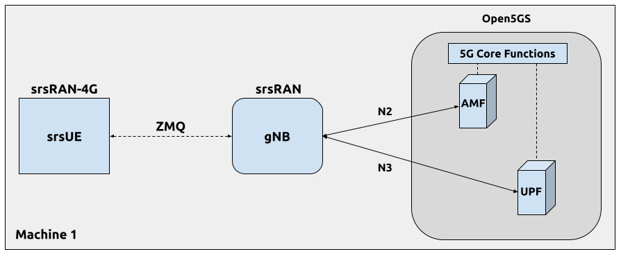

# Red 5G SA con OCUDU, srsUE y Open5GS en DragonOS

Instala una red 5G SA completamente software en una VM con **Open5GS nativo, OCUDU gNB y srsUE**, conectados mediante **ZeroMQ**. No requiere Docker ni equipos de radio.



Fuente de la figura: [tutorial oficial de OCUDU](https://docs.ocudu.org/tutorials/srsue/).

## Configuración del laboratorio

| Componente | Configuración |
|---|---|
| Sistema | DragonOS Focal R37 en VirtualBox; repositorios Jammy / Ubuntu 22.04 |
| Recursos de la VM | 5 vCPU y 10 GB de RAM |
| Open5GS | 2.8.0, instalación nativa con systemd |
| OCUDU | 26.10.0, revisión `b78d09a77a` |
| srsUE | 25.10.0, revisión `bef8680d5` |
| Celda | Banda n3 FDD, 5 MHz, SCS 15 kHz, 25 PRB |
| Muestreo | 5,76 MS/s en gNB y UE |
| Identidad | PLMN `00101`, TAC `7`, SST `1` |
| Sesión | DNN `internet`, IPv4, 5QI `9` |

Los archivos completos están en [config/](config/). La instalación sigue este orden: **MongoDB → Node.js → Open5GS → WebUI → OCUDU → srsRAN 4G**. Después se configura y se prueba la conexión.

## Contenido

1. [Entorno del laboratorio](#01-entorno-del-laboratorio)
2. [INSTALACION DE OPEN5GS](#02-instalacion-de-open5gs)
3. [Comprobar los servicios y las interfaces](#03-comprobar-los-servicios-y-las-interfaces)
4. [Compilar OCUDU](#04-compilar-ocudu)
5. [Actualizar srsRAN 4G](#05-actualizar-srsran-4g)
6. [Configurar el core](#06-configurar-el-core)
7. [Registrar el abonado](#07-registrar-el-abonado)
8. [Crear los archivos del gNB y del UE](#08-configurar-gnb-y-ue)
9. [Crear el namespace y arrancar la red](#09-arrancar-la-red)
10. [Configurar las rutas](#10-configurar-las-rutas)
11. [Probar la conectividad](#11-probar-la-conectividad)
12. [Prueba con iPerf3](#12-medir-con-iperf3)
13. [Detener y volver a arrancar](#13-detener-y-volver-a-arrancar)
14. [Solución de problemas](#14-solucion-de-problemas)
15. [Referencias](#15-referencias)

Ejecuta los comandos en **Bash dentro de la VM Linux**, respetando el orden de las secciones. Abre terminales separadas para gNB, UE y pruebas cuando se indique.

## 01. Entorno del laboratorio

Asigna 5 vCPU y 10 GB de RAM a la VM. Comprueba la base Ubuntu antes de añadir repositorios: los comandos de esta guía usan **Jammy / Ubuntu 22.04**.

Consulta la versión del sistema:

```bash
cat /etc/os-release
lsb_release -a
```

Si tu sistema muestra otra base Ubuntu, ajusta los repositorios a ella. No se necesita Docker para este montaje.

## 02. INSTALACION DE OPEN5GS

### 02.1. MongoDB

Actualiza los índices e instala las herramientas para gestionar las claves:

```bash
sudo apt-get update
sudo apt-get install gnupg curl
```

Si APT no puede descargar los índices, revisa el [diagnóstico de red](#141-apt-ppa-y-dns) antes de continuar.

Importa la clave pública de MongoDB si todavía no existe el keyring:

```bash
curl -fsSL https://pgp.mongodb.com/server-8.0.asc \
  | sudo gpg -o /usr/share/keyrings/mongodb-server-8.0.gpg --dearmor
```

Añade el repositorio de MongoDB 8.0 para Jammy, instala el paquete e inicia el servicio:

```bash
echo "deb [ arch=amd64,arm64 signed-by=/usr/share/keyrings/mongodb-server-8.0.gpg ] https://repo.mongodb.org/apt/ubuntu jammy/mongodb-org/8.0 multiverse" | sudo tee /etc/apt/sources.list.d/mongodb-org-8.0.list
sudo apt-get update
sudo apt-get install -y mongodb-org
sudo systemctl start mongod
sudo systemctl status mongod
```

Comprueba que el servicio muestre **active (running)**. Si quieres iniciarlo automáticamente al reiniciar la VM, ejecuta `sudo systemctl enable mongod`.

### 02.2. Node.js

Con MongoDB funcionando, instala Node.js:

```bash
curl -fsSL https://deb.nodesource.com/setup_18.x | sudo -E bash -
sudo apt install nodejs
```

El entorno de esta guía utiliza **Node.js 18.20.8**. Node 18 está fuera de soporte; si lo actualizas, valida la compatibilidad con la WebUI antes de continuar.

### 02.3. Open5GS

Primero intenta añadir el PPA de Open5GS:

```bash
sudo add-apt-repository ppa:open5gs/latest
```

Si el acceso a Launchpad devuelve un error de conexión, continúa con el repositorio OBS del bloque siguiente.

Configura el repositorio OBS para Ubuntu 22.04: instala las herramientas, descarga la clave, compruébala y añade el repositorio. Esta guía utiliza OBS para instalar los paquetes:

```bash
sudo apt install -y curl gnupg ca-certificates
curl -fsSL 'https://build.opensuse.org/projects/home:acetcom/signing_key' -o /tmp/open5gs-obs.asc
gpg --show-keys /tmp/open5gs-obs.asc
sudo gpg --dearmor --yes \
  -o /usr/share/keyrings/open5gs-obs.gpg \
  /tmp/open5gs-obs.asc
echo 'deb [signed-by=/usr/share/keyrings/open5gs-obs.gpg] https://download.opensuse.org/repositories/home:/acetcom:/open5gs:/latest/xUbuntu_22.04/ /' | sudo tee /etc/apt/sources.list.d/open5gs-obs.list
sudo apt update
apt-cache policy open5gs
sudo apt install open5gs
```

Comprueba los paquetes instalados y sus servicios:

```bash
dpkg -l | grep open5gs
systemctl --type=service --all | grep open5gs
sudo service open5gs-* status
```

Los archivos de configuración incluidos corresponden a **Open5GS 2.8.0**. Revisa `apt-cache policy open5gs`, porque el repositorio `latest` puede ofrecer una versión posterior.

Comprueba las interfaces antes de instalar la WebUI:

```bash
sudo apt-get install net-tools
ifconfig
```

En este laboratorio, la interfaz de VirtualBox es `enp0s3` con `10.0.2.15/24`, y la interfaz de datos del core es `ogstun` con `10.45.0.1/16`.

### 02.4. WebUI de Open5GS

Con MongoDB, Node.js y Open5GS instalados, ejecuta el instalador de la WebUI:

```bash
curl -fsSL https://open5gs.org/open5gs/assets/webui/install | sudo -E bash -
```

Si aparece `Could not resolve host: open5gs.org`, aplica el diagnóstico DNS siguiente. **Si la descarga funciona, pasa directamente a comprobar el servicio**.

Revisa la configuración DNS:

```bash
resolvectl status
cat /etc/resolv.conf
nmcli device show | grep -E 'GENERAL.DEVICE|IP4.DNS'
```

Aplica este ajuste temporal y comprueba la resolución:

```bash
sudo resolvectl dns enp0s3 8.8.8.8 1.1.1.1
sudo resolvectl domain enp0s3 '~.'
sudo resolvectl flush-caches
getent hosts google.com
getent hosts open5gs.org
curl -I --connect-timeout 10 https://open5gs.org
```

Sustituye `enp0s3` si tu interfaz tiene otro nombre. Este ajuste DNS es temporal.

Si tuviste que corregir DNS, vuelve a ejecutar el instalador. Después comprueba el servicio:

```bash
curl -fsSL https://open5gs.org/open5gs/assets/webui/install | sudo -E bash -
sudo systemctl status open5gs-webui
```

El servicio debe mostrar **active (running)**. El instalador crea y habilita `open5gs-webui.service`.

Abre **http://localhost:9999** en el navegador de la VM. Los datos iniciales de la guía son usuario `admin` y contraseña `1423`, si aún no se cambiaron. La WebUI se usará para registrar el abonado después de configurar la identidad del core.

## 03. Comprobar los servicios y las interfaces

Al terminar esta instalación deben estar presentes los servicios de Open5GS, la WebUI y `ogstun`. La secuencia anterior ya los inspecciona con `dpkg`, `systemctl`, `service` e `ifconfig`.

Continúa con OCUDU y después actualiza srsRAN 4G. La configuración del core se ajusta en el paso 06.

## 04. Compilar OCUDU

### 04.1. Crear la carpeta y clonar

```bash
git --version
mkdir -p ~/srsran_project
cd ~/srsran_project
git clone https://gitlab.com/ocudu/ocudu.git
```

### 04.2. Comprobar los archivos y las opciones

Comprueba los archivos y las opciones de compilación:

```bash
ls -la ~/srsran_project/ocudu
ls ~/srsran_project/ocudu/CMakeLists.txt
cd ~/srsran_project/ocudu
grep -n -i -E 'CXX|compiler|CMAKE_CXX_STANDARD' CMakeLists.txt
grep -n -i -E 'GCC|compiler|Ubuntu|ZeroMQ|ZEROMQ' README.md
grep -n -i -E 'ZEROMQ|ENABLE_EXPORT|UHD|SRSRAN.*RF' CMakeLists.txt
ls apps
```

Si CMake indica que falta una biblioteca, instala las [dependencias de OCUDU](#142-dependencias-y-compilacion) y vuelve a configurar.

### 04.3. Configurar, compilar y comprobar

```bash
cd ~/srsran_project/ocudu
mkdir -p build
cd build
cmake .. -DENABLE_ZEROMQ=ON -DENABLE_UHD=ON
make -j2
cd ~/srsran_project/ocudu/build
./apps/gnb/gnb --version
grep -E 'ENABLE_ZEROMQ:BOOL|ENABLE_UHD:BOOL' CMakeCache.txt
```

Comprueba la versión y que `ENABLE_ZEROMQ` y `ENABLE_UHD` estén en `ON`. Este laboratorio usa **OCUDU 26.10.0 (`b78d09a77a`)**. El gNB se ejecutará desde `build/apps/gnb`; no necesita una instalación global.

Las revisiones completas están en [versions.json](versions.json). Para fijar OCUDU antes de compilar, usa `git checkout b78d09a77ab060cda752f32483e551f1e9132f66` dentro de su repositorio.

### 04.4. Inspeccionar el core desde la VM

Revisa los servicios, la configuración de red y las rutas:

```bash
systemctl list-units --type=service --all 'open5gs-*' --no-pager
ls -l /etc/open5gs/amf.yaml /etc/open5gs/upf.yaml
sudo grep -n -A 18 -B 3 -E 'ngap:|plmn_support:|tai:|tac:|sst:|sd:' /etc/open5gs/amf.yaml
sudo grep -n -A 12 -B 3 -E 'pfcp:|gtpu:|dev:|addr:|subnet:' /etc/open5gs/upf.yaml
ip -br addr
ip route
```

Si el core conserva MCC/MNC `999/70` y TAC `1`, cámbialos en el paso 06 a `001/01` y TAC `7` para que coincidan con la celda.

## 05. Actualizar srsRAN 4G

### 05.1. Identificar los binarios anteriores

```bash
which srsenb
which srsepc
which srsue
srsenb --version
srsepc --version
srsue --version
```

La instalación anterior de DragonOS usa `/usr/local/bin/` y versión **23.4.0**. `srsepc` puede mostrar errores al no tener un EPC configurado; esta red utiliza Open5GS.

### 05.2. Instalar las dependencias

Instala las dependencias de srsRAN 4G:

```bash
sudo apt update
sudo apt install -y \
  git build-essential cmake pkg-config \
  libfftw3-dev libmbedtls-dev \
  libboost-program-options-dev libconfig++-dev \
  libusb-1.0-0-dev libzmq3-dev
```

### 05.3. Clonar y comprobar el tag inicial

Clona el código en una carpeta nueva. Si `~/srsRAN_4G_ocudu` ya contiene trabajo, consérvalo antes de repetir el clon.

```bash
cd ~
git clone https://github.com/srsran/srsRAN_4G.git srsRAN_4G_ocudu
cd srsRAN_4G_ocudu
git tag | grep 23_11
git checkout release_23_11
```

Después de comprobar `release_23_11`, cambia a `master` para continuar con la versión nueva.

### 05.4. Cambiar a master y configurar

```bash
cd ~/srsRAN_4G_ocudu
git checkout master
git log -1 --format='%h %ad %s' --date=short
git describe --tags --always
mkdir -p build && cd build
cmake ..
```

La revisión usada aquí es `bef8680d5`, descrita como `release_25_10-14-gbef8680d5`. Su CMake usa Release y habilita ZeroMQ por defecto. Para fijar esa revisión antes de compilar, usa `git checkout bef8680d5f9714f3e040e6f9cbc88d7888439b6d` dentro del repositorio de srsRAN 4G.

### 05.5. Compilar y localizar el ejecutable nuevo

```bash
cmake --build . -j"$(nproc)"
find ~/srsRAN_4G_ocudu/build -type f -name srsue -executable
./srsue/src/srsue --version
```

Comprueba **Version 25.10.0** y ZeroMQ entre los plugins activos. El ejecutable queda en `~/srsRAN_4G_ocudu/build/srsue/src/srsue`.

Desde ahora se usa `~/srsRAN_4G_ocudu/build/srsue/src/srsue`; escribir solo `srsue` puede seguir lanzando la versión anterior de `/usr/local/bin`. No se reemplazó esa instalación mediante `make install`.

## 06. Configurar el core

Después de compilar ambos programas se comprueba y ajusta la identidad del core. Los archivos finales se incluyen en la carpeta `config/open5gs/` del repositorio para consultar su contenido durante la edición.

### Direcciones finales

| Interfaz / función | Dirección | Protocolo o función |
|---|---|---|
| AMF N2 | `127.0.0.5:38412` | NGAP / SCTP; puerto estándar usado por gNB |
| gNB N2 bind | `127.0.0.1` | Configurado en `cu_cp.amf.bind_addr` |
| AMF SBI | `127.0.0.5:7777` | HTTP / SBI |
| SMF PFCP | `127.0.0.4` | N4; UDP 8805 por defecto |
| UPF PFCP / GTP-U | `127.0.0.7` | N4 / N3; UDP 8805 / 2152 por defecto |
| NRF SBI | `127.0.0.10:7777` | Descubrimiento de funciones |
| SCP | `127.0.0.200:7777` | Proxy SBI usado por AMF y SMF |
| Pool IPv4 | `10.45.0.0/16` | Sesiones SMF/UPF |
| `ogstun` en la VM | `10.45.0.1/16` | Gateway de datos; MTU observado 1400 |
| `tun_srsue` en `ue1` | `10.45.0.3/24` en la prueba | IP de sesión dinámica; máscara de `[gw]` |

N3 y N4 usan sus puertos predeterminados cuando el YAML no define otro. `gnb_zmq.yaml` configura el bind N2 en `127.0.0.1`; no define un bind N3 explícito.

### 06.1. Verificar los valores iniciales

Comprueba los servicios, la dirección del AMF y la interfaz de datos:

```bash
systemctl list-units | grep -i open5gs
grep -n -A4 'ngap:' /etc/open5gs/amf.yaml
ip addr show ogstun
```

### 06.2. Copia de seguridad y cambio del AMF

```bash
sudo cp /etc/open5gs/amf.yaml /etc/open5gs/amf.yaml.bak
sudo cp /etc/open5gs/nrf.yaml /etc/open5gs/nrf.yaml.bak
sudo nano /etc/open5gs/amf.yaml
```

En el AMF cambia los bloques **guami**, **tai** y **plmn_support** a MCC `001` / MNC `01`. En `tai` se fija TAC `7`; en `plmn_support`, SST `1`. Se conserva NGAP en `127.0.0.5`.

El contenido completo final está en [config/open5gs/amf.yaml](config/open5gs/amf.yaml). Los bloques `999/70` que permanezcan en comentarios son ejemplos, no configuración activa. Conserva los ceros iniciales de MCC/MNC.

### 06.3. Cambio del NRF y reinicio

```bash
sudo nano /etc/open5gs/nrf.yaml
```

En `nrf.serving`, el `plmn_id` queda con MCC `001` y MNC `01`. Se conserva el servidor SBI `127.0.0.10:7777`. Reinicia los dos servicios modificados:

```bash
sudo systemctl restart open5gs-nrfd open5gs-amfd
systemctl is-active open5gs-nrfd open5gs-amfd
```

Comprueba que ambos servicios respondan `active`.

Comprueba también [smf.yaml](config/open5gs/smf.yaml) y [upf.yaml](config/open5gs/upf.yaml): PFCP entre `127.0.0.4` y `127.0.0.7`, GTP-U en `127.0.0.7`, pool `10.45.0.0/16` y gateway `10.45.0.1`.

Los cuatro archivos completos están en `config/open5gs/`. Úsalos como referencia al editar los archivos de `/etc/open5gs/`.

## 07. Registrar el abonado

Comprueba la WebUI antes de registrar el abonado:

```bash
sudo systemctl status open5gs-webui
```

En la WebUI de la VM, abre **Subscriber → +**, configura los siguientes valores y guarda:

| Campo | Valor del laboratorio |
|---|---|
| IMSI | `001010123456780` |
| Subscriber Key / K | `00112233445566778899aabbccddeeff` |
| Tipo de clave de operador | `OPc` |
| OPc | `63BFA50EE6523365FF14C1F45F88737D` |
| Authentication Management Field | `8000` |
| DNN / APN de la sesión | `internet` |
| SST | `1` |
| 5QI | `9` |

Son credenciales de prueba del ejemplo, también presentes en el archivo UE. El campo de autenticación `AMF=8000` no es la dirección de la función de red AMF. No fijes como IP estática `10.45.0.3`: fue la IP asignada en la prueba.

## 08. Configurar gNB y UE

Crea los archivos para una celda de 5 MHz, con 25 PRB y 5,76 MS/s en ambos extremos.

### 08.1. Crear la configuración del gNB

```bash
mkdir -p ~/zmq_test
cat > ~/zmq_test/gnb_zmq.yaml << 'EOF'
cu_cp:
  amf:
    addr: 127.0.0.5
    port: 38412
    bind_addr: 127.0.0.1
    supported_tracking_areas:
      - tac: 7
        plmn_list:
          - plmn: "00101"
            tai_slice_support_list:
              - sst: 1
  inactivity_timer: 7200

ru_sdr:
  device_driver: zmq
  device_args: tx_port=tcp://127.0.0.1:2000,rx_port=tcp://127.0.0.1:2001,base_srate=5.76e6
  srate: 5.76
  tx_gain: 0
  rx_gain: 0

cell_cfg:
  pdsch:
    mcs_table: qam64
  pusch:
    mcs_table: qam64
  dl_arfcn: 368500
  band: 3
  channel_bandwidth_MHz: 5
  common_scs: 15
  plmn: "00101"
  tac: 7
  pdcch:
    common:
      ss0_index: 0
      coreset0_index: 0
    dedicated:
      ss2_type: common
      dci_format_0_1_and_1_1: false
  prach:
    prach_config_index: 1
EOF
```

Archivo final incluido: [config/gnb_zmq.yaml](config/gnb_zmq.yaml).

### 08.2. Crear la configuración del UE

```bash
cat > ~/zmq_test/ue_zmq.conf << 'EOF'
[rf]
freq_offset = 0
tx_gain = 50
rx_gain = 40
srate = 5.76e6
nof_antennas = 1
device_name = zmq
device_args = tx_port=tcp://127.0.0.1:2001,rx_port=tcp://127.0.0.1:2000,base_srate=5.76e6

[rat.eutra]
dl_earfcn = 2850
nof_carriers = 0

[rat.nr]
bands = 3
nof_carriers = 1
max_nof_prb = 25
nof_prb = 25

[rrc]
release = 15
ue_category = 4

[usim]
mode = soft
algo = milenage
opc  = 63BFA50EE6523365FF14C1F45F88737D
k    = 00112233445566778899aabbccddeeff
imsi = 001010123456780
imei = 353490069873319

[nas]
apn = internet
apn_protocol = ipv4

[gw]
netns = ue1
ip_devname = tun_srsue
ip_netmask = 255.255.255.0
EOF
```

Archivo final incluido: [config/ue_zmq.conf](config/ue_zmq.conf). También puedes usar los archivos completos incluidos en `config/`.

### Comprobar coherencia antes de ejecutar

| Parámetro | gNB | srsUE |
|---|---|---|
| DL | TX TCP 2000 | RX TCP 2000 |
| UL | RX TCP 2001 | TX TCP 2001 |
| Muestreo | `srate: 5.76` en MHz | `srate = 5.76e6` en muestras/s |
| Base ZeroMQ | `base_srate=5.76e6` | `base_srate=5.76e6` |
| Ancho de banda | `5` MHz | `25` PRB en ambos campos |

```bash
grep -nE 'srate|channel_bandwidth|coreset0|mcs_table' ~/zmq_test/gnb_zmq.yaml
grep -nE 'srate|prb|netns|ip_devname' ~/zmq_test/ue_zmq.conf
```

Esta revisión de srsUE usa por defecto DL ARFCN **368500** y SSB ARFCN **368410**, coincidentes con la celda configurada. No hace falta añadir opciones SSB al archivo UE para este perfil.

## 09. Arrancar la red

### 09.1. Crear el namespace

```bash
sudo ip netns add ue1
sudo ip netns list
```

Este paso se ejecuta antes de arrancar el UE. Si `ue1` ya existe, omite su creación y comprueba la lista.

### 09.2. Terminal 1: comprobar el core

```bash
systemctl is-active open5gs-amfd open5gs-upfd open5gs-nrfd open5gs-smfd
```

Los cuatro servicios deben estar `active`.

### 09.3. Terminal 2: gNB

```bash
cd ~/srsran_project/ocudu/build/apps/gnb
sudo ./gnb -c ~/zmq_test/gnb_zmq.yaml
```

Espera a ver la celda de **5 MHz** y la conexión al AMF:

```text
Cell pci=1, bw=5 MHz, 1T1R, dl_arfcn=368500 (n3)
Connected to AMF. Supported PLMNs: 00101
==== gNB started ===
```

La salida también muestra DL 1842,5 MHz, SSB ARFCN 368410 y UL 1747,5 MHz. Son parámetros lógicos de la celda; en este montaje las muestras viajan por TCP, no se emite RF física.

### 09.4. Confirmar la aceptación en el AMF

Para inspeccionar el core en una terminal adicional:

```bash
sudo tail -n 20 /var/log/open5gs/amf.log
```

`gNB-N2 accepted[127.0.0.1]` confirma el lado AMF. No basta con que `systemctl` muestre procesos activos para concluir que existe una sesión de datos.

### 09.5. Terminal 3: srsUE

```bash
cd ~/zmq_test
sudo ~/srsRAN_4G_ocudu/build/srsue/src/srsue ue_zmq.conf
```

Espera la confirmación de acceso, conexión RRC y sesión PDU:

```text
Random Access Complete.
RRC Connected
PDU Session Establishment successful. IP: 10.45.0.3
RRC NR reconfiguration successful.
```

Para diagnóstico puedes añadir `--log.filename=stdout --log.all_level=info`; no es una condición demostrada para que conecte.

**No arranques el proceso srsUE completo con `ip netns exec ue1`.** Se ejecuta en la red principal para acceder al mismo loopback TCP que el gNB. Su sección `[gw]` coloca la interfaz TUN en `ue1`; las aplicaciones ping/iPerf3 sí se lanzan en ese namespace.

## 10. Configurar las rutas

Con la sesión activa, añade la ruta por defecto y comprueba las tablas:

```bash
sudo ip netns exec ue1 ip route add default via 10.45.0.1 dev tun_srsue
sudo ip netns exec ue1 route -n
route -n | grep 10.45
```

Si aparece `RTNETLINK answers: File exists`, comprueba la tabla: la ruta puede estar ya añadida. Si falta la interfaz, revisa la sesión con `sudo ip netns exec ue1 ip addr show tun_srsue`.

En `ue1` se espera una ruta por defecto vía `10.45.0.1` y una ruta conectada `10.45.0.0/24` por `tun_srsue`. En el host ya existe `10.45.0.0/16` por `ogstun`. La máscara `/24` del UE y el pool `/16` del core son exactamente los de esta prueba.

**No añadas `10.45.0.0/16 via 10.53.1.2`.** Esa ruta era del core Docker del tutorial de referencia. Aquí el core es nativo y su interfaz `ogstun` está en la propia VM.

## 11. Probar la conectividad

### Iniciar ping desde el UE (UL)

```bash
sudo ip netns exec ue1 ping 10.45.0.1 -c 4
```

### Iniciar ping desde el host hacia el UE (DL)

Sustituye `10.45.0.3` por la dirección que haya recibido tu UE si es distinta:

```bash
ping 10.45.0.3 -c 4
```

| Prueba del laboratorio | Enviados / recibidos | Pérdida | RTT medio |
|---|---|---|---|
| Desde `ue1` hacia `10.45.0.1` | 4 / 4 | 0 % | 358,567 ms |
| Desde el host hacia `10.45.0.3` | 4 / 4 | 0 % | 214,461 ms |

Cada ping incluye solicitud y respuesta; UL/DL indica el lado que lo inicia. Esto respalda conectividad bidireccional local, sin demostrar rendimiento sostenido ni acceso WAN.

## 12. Medir con iPerf3

Instala iPerf3 y arranca el servidor:

```bash
sudo apt install -y iperf3
iperf3 -s -i 1
```

El servidor corre en el host de la VM, fuera de `ue1`, y escucha en el puerto 5201.

En otra terminal, inicia el cliente TCP dentro del namespace:

```bash
sudo ip netns exec ue1 iperf3 -c 10.45.0.1
```

Espera el resumen final del emisor y del receptor antes de evaluar el rendimiento.

Para limitar una prueba TCP a 30 segundos:

```bash
sudo ip netns exec ue1 iperf3 -c 10.45.0.1 -t 30 -i 1
```

Después de terminarla, puedes probar el sentido inverso:

```bash
sudo ip netns exec ue1 iperf3 -c 10.45.0.1 -t 30 -i 1 -R
```

Para UDP, empieza con una carga moderada:

```bash
sudo ip netns exec ue1 iperf3 -c 10.45.0.1 -u -b 300K -t 30 -i 1
```

Evalúa la tasa recibida. En UDP revisa también jitter y pérdida; en TCP, retransmisiones.

El nombre DNN `internet` no demuestra acceso WAN: lo validado aquí es conectividad local entre UE y core.

## 13. Detener y volver a arrancar

1. Termina el cliente iPerf3 y su servidor con `Ctrl+C`.
2. Termina srsUE en su terminal con `Ctrl+C` y espera a que salga.
3. Termina el gNB en su terminal con `Ctrl+C` y espera a que salga.
4. Los servicios Open5GS pueden seguir activos para la próxima prueba.

Para otra sesión: verifica el core, comprueba `ue1`, arranca gNB y luego srsUE, confirma la nueva IP de `tun_srsue` y vuelve a establecer la ruta. Tras reiniciar la VM, el namespace no persiste automáticamente. No se creó una automatización de gNB/UE.

Para guardar el estado de la VM sin alterar la red:

```bash
bash scripts/recoger-estado.sh
```

Se genera una carpeta local `estado-vm-*`, ignorada por Git, con versiones, archivos e interfaces para diagnóstico. No incluye `.env` de WebUI ni un dump de MongoDB.

## 14. SOLUCION DE PROBLEMAS

### 14.1. APT PPA y DNS

| Error | Acción |
|---|---|
| `Connection refused` al acceder a `archive.ubuntu.com:80` | Revisa la conectividad y el acceso HTTP al repositorio. No lo confundas con un error DNS. |
| `ConnectionRefusedError` al añadir el PPA de Open5GS | Usa el repositorio OBS de la sección 02.3 para la base Ubuntu correspondiente. |
| `Could not resolve host: open5gs.org` | Revisa `resolvectl` y aplica el ajuste DNS de la sección 02.4 si corresponde. |
| APT conserva índices antiguos | Repite `sudo apt-get update` después de corregir la conectividad y comprueba que pueda descargar los índices necesarios. |

El DNS temporal configurado con `resolvectl` puede perderse al reiniciar. Si vuelve a fallar la resolución, revisa la conexión de NetworkManager y su configuración DNS.

### 14.2. Dependencias y compilacion

Si CMake no encuentra las bibliotecas del gNB, instala las dependencias y vuelve a ejecutar la configuración:

```bash
sudo apt update
sudo apt install -y \
  git build-essential cmake pkg-config \
  libfftw3-dev libmbedtls-dev libsctp-dev libyaml-cpp-dev libgtest-dev \
  libzmq3-dev libuhd-dev
```

Si la compilación agota la memoria, reduce el paralelismo. En el directorio de construcción:

```bash
cmake --build . -j2
```

Antes de conectar el UE, comprueba que el gNB y srsUE incluyan ZeroMQ entre los drivers o plugins disponibles.

### 14.3. srsUE sigue mostrando 23.4.0

La instalación de DragonOS puede seguir resolviendo a `/usr/local/bin/srsue`. Comprueba ambas versiones:

```bash
command -v srsue
srsue --version
~/srsRAN_4G_ocudu/build/srsue/src/srsue --version
```

Ejecuta el último binario por su ruta completa. No necesitas eliminar la instalación anterior. `srsepc` no participa en esta red: el core es Open5GS.

### 14.4. Ancho de banda muestreo y CORESET

| Síntoma | Corrección |
|---|---|
| Tasa insuficiente para un canal de 20 MHz | Mantén el perfil de esta guía: 5 MHz y 5,76 MS/s en ambos extremos. |
| No se puede derivar una combinación válida SSB/Point A | Revisa ancho, frecuencia y CORESET#0. El perfil de 5 MHz incluido utiliza índice 0. |
| Error de tabla 256QAM con DCI fallback | Configura `mcs_table: qam64` en PDSCH y PUSCH. |
| El UE no detecta la celda | Comprueba banda, ARFCN, tasa y puertos ZeroMQ cruzados. |

Para el perfil de 5 MHz, `max_nof_prb` y `nof_prb` deben ser **25**, no 52. El ancho de banda no se deduce únicamente de `base_srate`; revisa también `channel_bandwidth_MHz` en el gNB.

El índice CORESET debe ser válido para la combinación completa de parámetros. No reutilices sin revisar el índice de un perfil de otro ancho de banda.

### 14.5. Opciones SSB del UE

En la revisión de srsUE usada aquí, DL ARFCN 368500 y SSB ARFCN 368410 ya son valores por defecto. Las opciones de frecuencia reconocidas son `dl_nr_arfcn` y `ssb_nr_arfcn`; para la separación de subportadoras se utilizan `scs` y `ssb_scs`.

No añadas `ssb_nr_scs`, `ssb_nr_pattern` ni `ssb_nr_duplex_mode`: esos nombres no están registrados en el parser de esta revisión. El archivo incluido funciona con sus parámetros NR esenciales.

### 14.6. Namespace interfaz TUN y sesion

Si aparece `Failed to setup/configure GW interface`, verifica el namespace y la interfaz:

```bash
sudo ip netns list
sudo ip netns exec ue1 ip addr show tun_srsue
sudo ip netns exec ue1 ip route
```

Si no existe `ue1`, créalo antes de iniciar srsUE. Ejecuta srsUE con `sudo` desde la red principal de la VM, usando `[gw] netns = ue1` para su interfaz TUN.

`RRC Connected` por sí solo no confirma una sesión de datos. Comprueba también la asignación de IP y la presencia de `tun_srsue`. Si no se establece la sesión PDU, revisa que IMSI, K, OPc, DNN y SST coincidan con el abonado de Open5GS.

### 14.7. Ruta existente o IP incorrecta

`RTNETLINK answers: File exists` al repetir `ip route add` puede indicar que la ruta ya está creada. Comprueba la tabla y, si necesitas reemplazarla, ejecuta:

```bash
sudo ip netns exec ue1 ip route replace default via 10.45.0.1 dev tun_srsue
```

La dirección del UE puede cambiar al reconectar. Consulta la IP actual antes del ping desde el host; no asumas que sigue siendo `10.45.0.3` ni uses automáticamente la dirección de otro ejemplo.

El host debe llegar a `10.45.0.0/16` por `ogstun`. No desactives esa interfaz ni añadas la ruta Docker vía `10.53.1.2` en esta instalación nativa.

### 14.8. Latencia alta o perdida en iPerf3

Una VM con poca RAM o CPU disponible puede degradar la prueba. Cierra aplicaciones innecesarias, revisa la carga y conserva el perfil de 5 MHz antes de aumentar el ancho de banda.

```bash
free -h
top
```

El retraso de procesamiento es una causa posible, no un diagnóstico automático. Comprueba también configuración, rutas y resúmenes del receptor. Si UDP pierde paquetes a una tasa alta, prueba 300 Kbit/s y compara el resultado completo de ambos extremos.

## 15. Referencias

- [OCUDU: tutorial oficial con srsUE](https://docs.ocudu.org/tutorials/srsue/).
- [OCUDU: instalación](https://docs.ocudu.org/user_manual/installation/). Las opciones y requisitos actuales pueden variar respecto del commit fijado aquí.
- [Open5GS: Quickstart](https://open5gs.org/open5gs/docs/guide/01-quickstart/).
- [srsRAN 4G: ZeroMQ](https://docs.srsran.com/projects/4g/en/latest/app_notes/source/zeromq/source/index.html).
- [srsUE: opciones en el commit usado](https://github.com/srsran/srsRAN_4G/blob/bef8680d5f9714f3e040e6f9cbc88d7888439b6d/srsue/src/main.cc).
- [Repositorio que inspiró la presentación](https://github.com/devopsjourney23/my-srsproject-demo).

Consulta [versions.json](versions.json) para las revisiones de los programas y [solución de problemas](#14-solucion-de-problemas) si necesitas diagnosticar la conexión. Las herramientas enlazadas conservan sus propias licencias.
